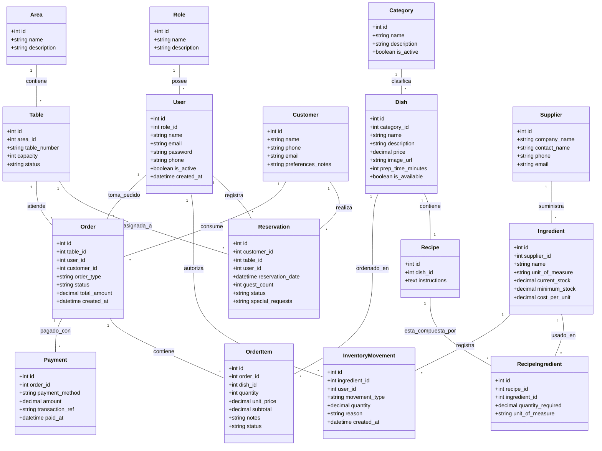

# 🗄️ Diseño de Base de Datos - Sistema de Restaurante "Las Brazas"

Este documento contiene el diseño de la base de datos relacional para el sistema de gestión del restaurante. Incluye el **Diagrama de Clases (UML / Entidad-Relación)** en Mermaid y el detalle de cada módulo.

---

## 📊 Diagrama de Clases (Mermaid)

---

## 📑 Detalle de Módulos y Tablas

### 1. 👥 Módulo de Usuarios y Roles (`users`, `roles`)
* **`roles`**: Maneja los niveles de acceso del sistema:
  * `Administrador`: Acceso total (reportes, usuarios, inventario, precios).
  * `Chef / Cocina`: Vista de recetas, comandas/pedidos pendientes e inventario.
  * `Mesero`: Toma de pedidos, gestión de mesas y estado de comandas.
  * `Recepcionista`: Gestión del mapa de mesas y reservas de clientes.
  * `Cliente`: (Opcional) Para realizar reservas web o consultar el menú digital.

### 2. 🪑 Módulo de Salón, Mesas y Reservas (`areas`, `tables`, `customers`, `reservations`)
* **`areas`**: Zonas del restaurante (ej: Terraza, Salón Principal, Zona VIP, Bar).
* **`tables`**: Representa las mesas físicas del restaurante:
  * `capacity`: Número de sillas/comensales por mesa.
  * `status`: `disponible`, `reservada`, `ocupada`, `mantenimiento`.
* **`reservations`**: Controla las citas de comensales:
  * Permite asociar la reserva a un cliente, fecha/hora, número de personas, mesa asignada y requerimientos especiales (ej: silla de bebé, cumpleaños).

### 3. 🍲 Módulo de Menú y Platillos (`categories`, `dishes`)
* **`categories`**: Entradas, Platos Fuertes, Bebidas, Postres, Menú Infantil, etc.
* **`dishes`**: Lista de productos que se venden al cliente (precio, foto, tiempo estimado de preparación, disponibilidad).

### 4. 📦 Módulo de Inventario e Insumos (`suppliers`, `ingredients`, `inventory_movements`)
* **`suppliers`**: Registro de proveedores que surten materia prima.
* **`ingredients`**: Ingredientes e insumos almacenados (ej: Carne Arrachera, Sal, Aceite, Cerveza):
  * `unit_of_measure`: Kilogramos, Gramos, Litros, Mililitros, Unidades.
  * `minimum_stock`: Dispara alertas automáticas de bajo stock cuando el inventario cae por debajo de este límite.
* **`inventory_movements`**: Historial de entradas (compras a proveedores), salidas (descuento automático al vender un platillo), mermas o despilfarros y ajustes manuales.

### 5. 📜 Módulo de Recetas (`recipes`, `recipe_ingredients`)
* Relaciona **Platillos** con **Ingredientes**:
  * Ejemplo: 1 Platillo *"Tacos Arrachera"* requiere `250g` de Arrachera, `3` Tortillas, `50g` de Queso.
  * **Descuento Automático**: Al marcar un pedido como preparado/vendido, el sistema descuenta automáticamente las proporciones de ingredientes del inventario.

### 6. 💳 Módulo de Pedidos / Comandas y Pagos (`orders`, `order_items`, `payments`) *(Módulo Adicional Recomendado)*
* **`orders`**: Representa la cuenta o comanda de una mesa.
* **`order_items`**: Detalle de los platillos solicitados, cantidad, especificaciones de cocina (ej: "Sin cebolla", "Término medio") y su estado en cocina (`pendiente`, `en_preparación`, `listo`, `servido`).
* **`payments`**: Registro de pagos recibidos (efectivo, tarjeta, transferencia).

---

##💡 Sugerencias Adicionales Recomendadas

> [!TIP]
> 1. **Pantalla de Cocina (KDS - Kitchen Display System)**: Muestra en tiempo real los `order_items` ordenados por antigüedad para que los cocineros marquen lo que ya prepararon.
> 2. **Alerta de Mermas / Desperdicio**: Permitir al chef registrar si un ingrediente se dañó para no distorsionar el stock real.
> 3. **Unión de Mesas**: Agregar soporte para unir dos o más mesas en una sola reserva/pedido cuando acude un grupo grande.
